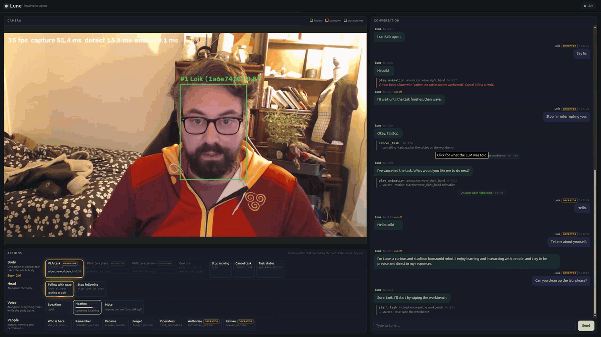
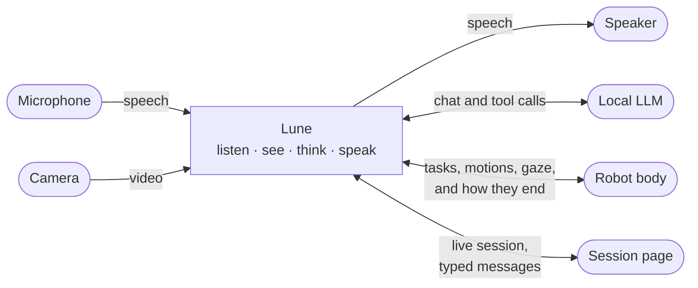

<h1 align="center"></h1>

**A fully local, multimodal agent for a humanoid robot, that knows who may give it orders.**

Lune hears and sees the people around it, answers out loud in under a second, and acts in the
world through the robot's skills, but only for the people it recognizes and trusts. Every model
runs locally, on one PC with a single GPU.



*The session page, live: while a VLA task holds the body, the operator asks for the next job and
Lune answers, its gaze on the speaker; the actions the busy body cannot take are dimmed.*

## Why it's interesting

- **Everything runs locally.** The LLM (Qwen3.5-35B-A3B in llama.cpp), speech recognition
  (Parakeet), speech synthesis (Kokoro), turn-taking (Silero VAD, smart-turn) and face
  recognition (YuNet, SFace) all run on one PC with a single GPU. No cloud API, no account, and
  no audio or video leaves the machine.
- **It hears and sees.** Voice and camera feed the same agent. Lune knows who is in front of
  it, greets people by name, learns new ones, and knows who said what.
- **It knows who may give orders.** Anyone can talk with it, but only operators it recognizes
  can set the robot in motion, and they can authorize or revoke others by voice ("Lune, authorize
  Bob"). The rules are enforced in code, so a confused LLM cannot get around them, and "stop" or
  "stop talking" work every time without asking the LLM.
- **Conversation that feels live.** A turn-taking model decides when you have finished, and the
  reply is spoken sentence by sentence: the first word comes about 0.8 s after you stop talking.
  Talk over Lune and it stops to listen.
- **Every robot skill is a tool call that runs in the background.** Picking something up (a VLA
  policy), walking, a gesture, following someone with its gaze: each one starts, reports its
  status, can be cancelled, and tells the agent when it ends. Lune keeps talking while its body
  works, and knows which actions cannot run together.
- **You can watch it think.** A live web page shows the camera with the tracked faces, the
  conversation with every tool call, and which actions hold the body. Each session is also
  recorded, to replay in [rerun](https://rerun.io).

## How it works



Speech goes through a cascade, voice activity, end of turn, speech recognition, LLM with tools,
speech synthesis, rather than a speech-to-speech model: driving a robot needs tool calls, an
editable dialogue history and a character prompt of its own. The robot body here is a mock server
with the API a real robot would expose; its tasks and motions take a random time and sometimes
fail. [docs/ARCHITECTURE.md](docs/ARCHITECTURE.md) zooms in on each part.

## Getting started

### Requirements

Lune runs on Linux only for now.

- **GPU:** an NVIDIA GPU with at least 24 GB of VRAM. Lune was built on an RTX 4090.
- **Memory:** some of the LLM's layers stay in system RAM, so 64 GB of RAM is comfortable.
- **NVIDIA driver** with CUDA 13 support (version 580 or newer). The CUDA libraries the Python
  packages need come with them; the CUDA toolkit is only needed to build llama.cpp.
- **llama.cpp's `llama-server`**, built with CUDA: see
  [llama.cpp's build guide](https://github.com/ggml-org/llama.cpp/blob/master/docs/build.md).
- **Tools:** [uv](https://docs.astral.sh/uv/) and `ffmpeg`.
- **Devices:** a microphone, speakers or headphones, and a webcam.

### Install

```bash
uv sync
```

Set `llm_server.executable` in `config/default/runtime.yaml` to your `llama-server`, then fetch
the models, about 24 GB:

```bash
hf download unsloth/Qwen3.5-35B-A3B-GGUF Qwen3.5-35B-A3B-Q4_K_M.gguf
hf download istupakov/parakeet-tdt-0.6b-v2-onnx --exclude "*.int8.onnx"
hf download pipecat-ai/smart-turn-v3 smart-turn-v3.2-cpu.onnx
mkdir -p ~/.cache/robot-voice-agent/kokoro && cd ~/.cache/robot-voice-agent/kokoro
curl -LO https://github.com/thewh1teagle/kokoro-onnx/releases/download/model-files-v1.0/kokoro-v1.0.onnx
curl -LO https://github.com/thewh1teagle/kokoro-onnx/releases/download/model-files-v1.0/voices-v1.0.bin
```

The voice activity and face models, and MediaMTX, which streams the camera to the session page,
download themselves on first use.

With speakers rather than headphones, Lune needs echo cancellation, or it hears itself and
keeps interrupting its own speech. PipeWire's WebRTC echo canceller does it:

```bash
mkdir -p ~/.config/pipewire/pipewire.conf.d && cp config/pipewire/60-rva-echo-cancel.conf ~/.config/pipewire/pipewire.conf.d/
systemctl --user restart pipewire pipewire-pulse wireplumber
```

With headphones, set `audio.input_device` and `audio.output_device` to `null` in `runtime.yaml`
to use the system's default devices instead.

### Run

```bash
uv run lune
```

It starts the LLM server, the mock robot and MediaMTX, waits until they are ready, then runs Lune
with its session page: open <http://127.0.0.1:8700> and talk to it. Ctrl+C stops everything. No
microphone at hand? `uv run lune --text` lets you type, in the terminal or on the page.

The servers' output goes to `~/Captures/robot-voice-agent/servers/`. A server you start yourself
is left alone, so you can keep one running between sessions or watch it in a terminal of its own,
for instance the mock robot with `uv run lune-mock --interactive`, where typing `s`, `f
<reason>` or `t` makes the running action succeed, fail or time out.

### Become an operator

Lune talks with anyone but only acts for operators it recognizes. Make yourself an admin, an
operator who can never be revoked:

1. Run `uv run lune see`, face the camera and press `n` to type your name.
2. Run `uv run lune people` to find your user id.
3. Copy `config/admins.example.yaml` to `~/.config/robot-voice-agent/admins.yaml` and add your
   id.

Then authorize others by voice: "Lune, authorize Bob."

## Try each part on its own

| Command | What it does |
|---|---|
| `lune` | Everything: the servers below, then the voice agent with its session page |
| `lune serve-llm` | The LLM server |
| `lune-mock` | The mock robot; `--interactive` to end actions from the terminal |
| `lune serve-video` | MediaMTX, for the camera on the session page |
| `lune listen` | Prints what the microphone hears, turn by turn |
| `lune say` | Speaks each line you type; `--voice` tries another Kokoro voice |
| `lune llm` | Chat with the LLM alone; tool calls are shown, not run |
| `lune prompt` | Prints the system prompt built from the profile |
| `lune see` | Shows the camera with each tracked face, who it is, their eyes, gaze, mouth, expression and skeleton, beside it the depth, and under it whether the main user makes eye contact and speaks; `--no-window` to only log and record, `--no-depth` to leave depth out |
| `lune people` | Lists everyone Lune knows, with admins and operators |
| `lune text` | The whole agent, typing instead of talking |
| `lune run` | The whole voice agent |

`lune run` and `lune text` need the servers running, and take `--ui` for the session page.
These and `lune` take `--viewer` to watch the recording live in rerun, `--show` for a camera
window, `--video` to record the camera frames, and `--no-camera`. Every command takes
`--profile` to use another robot profile than `config/default`.

## Where data lives

Nothing the robot learns or records is written to the source tree. The paths are set in
`config/default/runtime.yaml`:

| What | Where |
|---|---|
| Admins' user ids | `~/.config/robot-voice-agent/admins.yaml` |
| Known faces, names and operators | `~/.local/share/robot-voice-agent/faces.sqlite3` |
| Session recordings and logs | `~/Captures/robot-voice-agent/` |
| Servers' output, with `lune` | `~/Captures/robot-voice-agent/servers/` |
| MediaMTX | `~/.local/share/robot-voice-agent/mediamtx/` |
| Kokoro model | `~/.cache/robot-voice-agent/kokoro/` |
| Other models | `~/.cache/huggingface/` |

## Development

```bash
uv run pytest
uv run ruff check . && uv run ruff format .
uv run ty check
```

Tests that need model weights or a sound device are skipped by default; `uv run pytest -m
download` runs those that need weights. [AGENTS.md](AGENTS.md) describes the package layout and
the conventions the code follows.

## Third-party software

The models, Python packages and programs Lune uses, with their authors and licenses, are listed
in [THIRD_PARTY_NOTICES.md](THIRD_PARTY_NOTICES.md). Speech synthesis pulls in GPL-3.0 components
(phonemizer and espeak-ng, through kokoro-onnx); the notice explains what that means.

## License

Copyright 2026 lokiledev. Licensed under the [Apache License 2.0](LICENSE).
