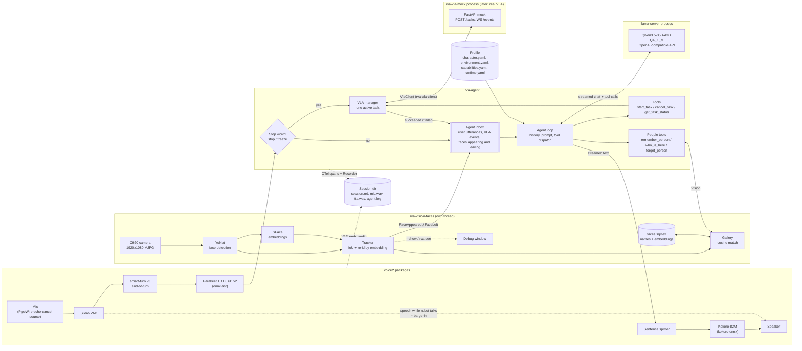
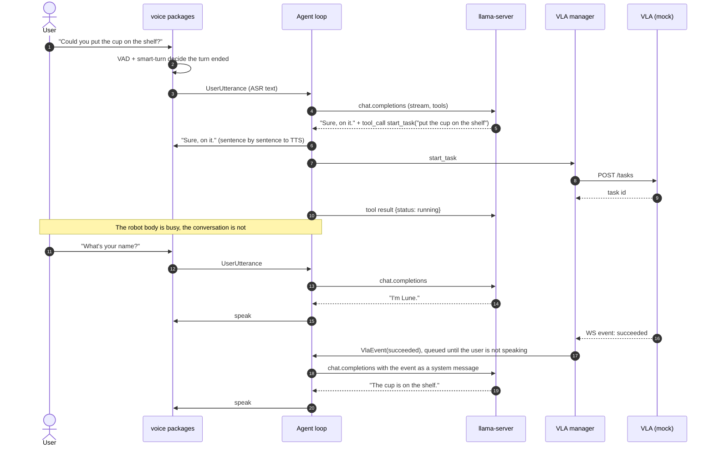
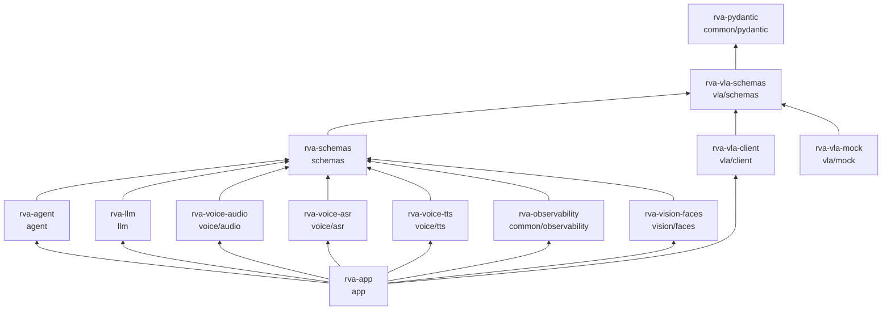

# Architecture

A local voice agent that is the high-level reasoning and interaction loop of a humanoid robot. It listens to people, answers them, and sends short-horizon natural-language tasks to the robot's VLA policy. The VLA runs elsewhere; we talk to it through an API, mocked for now.

Everything runs on one PC: RTX 4090 (24 GB), Ryzen 9 7950X3D, 64 GB RAM.

## Why a cascade and not speech-to-speech

Speech-to-speech models like Kyutai's Moshi reason over audio tokens. They have no text dialogue history you can edit, no tool calling, and their system prompt cannot be swapped for your own character and environment. That rules them out for an agent that has to drive a robot.

Kyutai's own answer to this is Unmute, which is a cascade: streaming speech-to-text, any text LLM, streaming text-to-speech. We use the same shape:

```
VAD → turn detection → ASR → LLM with tools → TTS
```

The dialogue history is the list of LLM messages. Tool calls are ordinary OpenAI-style function calls handled in Python. No MCP layer.

## System diagram



## A turn, end to end



## Runtime behaviour

**One agent loop, one inbox.** The agent consumes a single asyncio queue of user utterances and VLA events, one turn at a time, so the history is never written by two turns at once. VLA events that arrive while the user is speaking wait until the turn is over.

**VLA tasks are concurrent with dialogue.** `start_task` returns as soon as the VLA accepts the task. The VLA manager watches the status stream and posts the final status to the inbox. The LLM then decides what to say and whether to chain the next step of a longer plan ("clear the table" becomes several short VLA commands, each started when the previous one succeeds).

**One active task.** If the user asks for something physical while a task is running, the LLM chooses between `cancel_task` and asking the user to wait. There is no queue.

**Stop word.** If a transcript is just "stop", "freeze", "halt" or similar, the VLA manager cancels the active task directly, before the LLM sees anything. The LLM is then told it happened.

**Barge-in.** While the robot is speaking, speech detected by the VAD stops playback, cancels the LLM stream, and trims the last assistant message to what was actually said. Three layers keep the robot from interrupting itself through the speakers:
- PipeWire's WebRTC echo canceller (`config/pipewire/60-rva-echo-cancel.conf`): the robot plays into `rva_ec_sink` and listens on `rva_ec_source`, from which its own voice is subtracted.
- While the robot speaks, a barge-in needs clearer and longer speech (`barge_in_threshold`, `barge_in_min_speech_ms`).
- A transcript that mostly repeats what the robot said in the last 2 s is dropped as its own echo (`RobotSpeech`, `echo_window_ms`).

**Turn detection.** About 200 ms after the VAD hears silence, smart-turn v3 judges from the audio whether the user has finished. If it says no, we keep listening, up to a hard 1.5 s silence cutoff. All thresholds live in `runtime.yaml`.

**Streaming to TTS.** LLM tokens are cut into sentences and each sentence goes to TTS as soon as it is complete, so the robot starts speaking before the LLM has finished.

**History.** Only the current session is kept. When the context fills, the oldest turns are dropped (the system prompt is always kept).

**Wake word.** Off by default; the robot listens all the time. openWakeWord can be turned on in `runtime.yaml`.

**People.** With a camera, faces that stay in view for 0.5 s are announced to the agent and faces out of view for 3 s are said to have left. An appearance starts a turn, so the robot can greet a known person by name or ask the nearest unknown person theirs; a departure only goes into the history. A known person coming back within 5 minutes of leaving is not greeted again. See [Vision](#vision).

**Text mode.** `rva text` swaps the voice packages for a terminal `UserInput` and `SpeechOutput`, and TTS is optional. Use it to work on prompts and tools, and for scripted tests.

## Models

| Task | Model | Runtime | Device | Approx. VRAM |
|---|---|---|---|---|
| Echo cancellation | WebRTC AEC | PipeWire `module-echo-cancel` | CPU | — |
| Voice activity | Silero VAD v5 | onnxruntime | CPU | — |
| End of turn | smart-turn v3 (Pipecat) | onnxruntime | CPU | — |
| Speech to text | Parakeet TDT 0.6B v2 (English) | onnx-asr | GPU | ~2 GB |
| Dialogue and tools | Qwen3.5-35B-A3B, Q4_K_M GGUF | llama.cpp `llama-server --jinja` | GPU, some experts on CPU | ≤ 16 GB |
| Text to speech | Kokoro-82M | kokoro-onnx | GPU | ~1 GB |
| Wake word (optional) | openWakeWord | onnxruntime | CPU | — |
| Face detection | YuNet 2023mar (opencv_zoo), 232 KB | onnxruntime-gpu | GPU | < 0.5 GB with SFace |
| Face embeddings | SFace 2021dec (opencv_zoo), 38.7 MB | onnxruntime-gpu | GPU | (above) |

**LLM.** Qwen3.5-35B-A3B is a mixture-of-experts model with about 3B parameters active per token, so it generates much faster than a dense 27B model of similar quality. At Q4_K_M it is about 20 GB, more than fits beside ASR and TTS, so `--n-cpu-moe` keeps some expert layers in system RAM and the 7950X3D runs them. Tune that number until the LLM fits in about 16 GB, and keep context around 16k tokens. Thinking mode is off: these are short dialogue turns and latency matters more. The harness only talks to the OpenAI-compatible endpoint, so another model is a config change.

**ASR.** VAD already decides where an utterance ends, so we do not need a streaming model: Parakeet on a whole utterance takes about 30–60 ms on the 4090 and is among the most accurate English models. NVIDIA's Nemotron Speech Streaming 0.6B is the upgrade path if we later want partial transcripts, but it pulls in NeMo and torch.

**TTS.** Kokoro is far faster than real time, sounds good in English, ships several preset voices and is Apache-licensed. It cannot clone a voice. The `TTS` interface lets Chatterbox-Turbo (500M, voice cloning) replace it later if the robot needs a specific voice.

**Latency target.** Under 1 s from the end of speech to the first audio, 1.5 s at most. Rough budget: 200 ms end-of-turn wait, 50 ms ASR, 300–500 ms to the LLM's first sentence, 100 ms TTS for the first sentence.

## Packages

The repository is one uv workspace. Each domain has a `schemas` package with its data types and its interfaces (`typing.Protocol`s in `abc/`), and implementations sit in sibling packages that depend on the schemas, never on each other. Only `rva-app` imports implementations; it is the composition root.



| Package | Contents | Heavy dependencies |
|---|---|---|
| `rva-pydantic` | `RVABaseModel` (frozen, `extra="forbid"`, attribute docstrings), `load_yaml` | — |
| `rva-vla-schemas` | `TaskRequest`, `Task`, `TaskStatus` (running, succeeded, failed with a reason, cancelled), `TaskEvent`, errors; `abc.VlaClient` | — |
| `rva-schemas` | `AudioClip`; dialogue messages, `ToolCall`, `ToolSpec`, `UserUtterance`, `Spoken`; `Record` entries; `Profile` models; `TrackedFace`, `KnownPerson`, `FaceAppeared`, `FaceLeft`. Interfaces in `abc/`: `UserInput`, `SpeechOutput`, `SpeechRecognizer`, `SpeechSynthesizer`, `LanguageModel`, `Recorder`, `Vision` | numpy |
| `rva-agent` | Dialogue loop, history, system prompt, tools, task supervisor, stop word | — |
| `rva-llm` | `LanguageModel` over the OpenAI API; llama-server launch settings | openai |
| `rva-voice-audio` | Mic and speaker, Silero VAD, smart-turn, barge-in; implements `UserInput` and `SpeechOutput` from a `SpeechRecognizer` and a `SpeechSynthesizer` | onnxruntime-gpu, sounddevice |
| `rva-voice-asr` | Parakeet `SpeechRecognizer` | onnx-asr |
| `rva-voice-tts` | Kokoro `SpeechSynthesizer` | kokoro-onnx |
| `rva-observability` | loguru sinks, OpenTelemetry setup, span-to-rerun processor, rerun `Recorder` | rerun-sdk, opentelemetry-sdk |
| `rva-vision-faces` | Camera, YuNet detector, SFace embedder, tracker, gallery, SQLite face database, debug window; implements `Vision` | onnxruntime-gpu, opencv-python, onnx |
| `rva-vla-client` | HTTP + WebSocket `VlaClient` | httpx, websockets |
| `rva-vla-mock` | FastAPI mock server and terminal mode | fastapi, uvicorn |
| `rva-app` | cyclopts CLI (`run`, `run --text`, `up`), runtime config, terminal `UserInput`/`SpeechOutput` for text mode | — |

### Interfaces the agent sees

The agent depends on five Protocols and nothing concrete, so it runs the same with the voice stack, the terminal, or test fakes:

```python
class UserInput(Protocol):
    def utterances(self) -> AsyncIterator[UserUtterance]: ...


class SpeechOutput(Protocol):
    async def say(
        self, sentences: AsyncIterator[str]
    ) -> Spoken: ...  # Spoken.interrupted on barge-in


class LanguageModel(Protocol):
    def stream(
        self, messages: Sequence[Message], tools: Sequence[ToolSpec]
    ) -> AsyncIterator[TextDelta | ToolCall]: ...


class VlaClient(Protocol):
    async def start(self, request: TaskRequest) -> Task: ...  # raises VlaBusyError
    async def cancel(self, task_id: UUID) -> Task: ...
    async def get(self, task_id: UUID) -> Task: ...
    def events(self) -> AbstractAsyncContextManager[AsyncIterator[TaskEvent]]: ...  # subscription


class Recorder(Protocol):
    def record(self, entry: Record) -> None: ...
```

Barge-in stays inside `SpeechOutput.say`: it stops consuming the sentence stream, which in turn stops the LLM stream, and returns what was actually heard so the agent can trim its history. VLA status events become `RobotEventMessage`s in the history; each `LanguageModel` implementation decides how to render them, since chat templates differ on where system messages are allowed.

### Inside rva-agent

| Module | Responsibility |
|---|---|
| `prompt` | Render the system prompt from `Profile` with Jinja |
| `history` | Message list, trimming to the context budget, truncation after barge-in |
| `tools` | `start_task`, `cancel_task`, `get_task_status`: pydantic argument models, `ToolSpec` generation, dispatch |
| `people` | `remember_person`, `who_is_here`, `forget_person`, over `Vision`; only offered when there is a camera |
| `tasks` | Task supervisor: one active task, watches `VlaClient.events`, stop-word cancel |
| `loop` | The agent: one inbox of utterances and task events, one turn at a time |

## Vision

`rva-vision-faces` watches the camera in a thread of its own and implements the `Vision` Protocol:

```python
class Vision(Protocol):
    def events(self) -> AbstractAsyncContextManager[AsyncIterator[FaceEvent]]: ...  # subscription
    def faces(self) -> tuple[TrackedFace, ...]: ...
    async def remember(
        self, track_id: int, name: str
    ) -> Remembered: ...  # raises UnknownTrackError
    async def forget(self, name: str) -> KnownPerson: ...  # raises UnknownPersonError
```

**Per frame.** The C920 gives 1920x1080 MJPG. YuNet runs on the whole frame in onnxruntime with CUDA (`device: cpu` in `runtime.yaml` moves both models to the CPU; there is no silent fallback). The opencv_zoo export fixes its input to 640x640, so the input dims are made dynamic when the model loads, and the anchor decoding and non-maximum suppression that `cv2.FaceDetectorYN` would do are in `detector.py`. Faces shorter than 12% of the frame are ignored as too far away. pip's OpenCV has no CUDA, so OpenCV only captures, aligns, draws and shows.

**Tracking.** A detection continues the track whose last box it overlaps most (IoU ≥ 0.3). One that overlaps none is compared by embedding with the announced tracks that did not find their face in this frame, so a face keeps its track number across a fast move or a short occlusion; otherwise it starts a new track. A new track must be seen on every frame for 0.5 s to be announced (`FaceAppeared`); an announced track is said to have left after 3 s out of sight (`FaceLeft`). Each track gets an SFace embedding when it starts and then every second, and keeps the last 5.

**Recognition.** A track is someone when the best cosine similarity between its samples and that person's is at least 0.363 (OpenCV's value for SFace) and beats the next person by 0.05; otherwise it is unknown. Two tracks in view never get the same person: the better score wins. The nearest person is the largest face in view; there is no active speaker detection.

**Memory.** Names and embeddings live in a SQLite file, `~/.local/share/robot-voice-agent/faces.sqlite3` (`people` and `embeddings` tables, 128 float32 per row, at most 10 per person). It is loaded into memory and matched with numpy; each change is one transaction followed by a reload. `remember` stores the track's latest samples under the name, creating the person if the name is new; a face recognized as someone else is moved to the new name, and the result says who it was taken for. A misheard name is fixed by forgetting it and remembering again. No image is stored, and no frame goes to the rerun recording.

**What the LLM sees.** Events become `RobotEventMessage`s: "Alice is in view (track 7, nearest).", "An unknown person is in view (track 8).", "Alice left (track 7).". The system prompt section *People around you* tells it to greet known people, ask the nearest unknown person their name once, stay quiet for others or mid-conversation, and call `remember_person(track_id, name)` only with a name it was told.

**Measured** on the 4090 and 7950X3D at 1920x1080: detection about 5.6 ms per frame including the upload, an SFace embedding well under 1 ms, so the loop follows the camera (24 fps in the room's light, 30 fps at most). `rva see` shows these figures over the image; they are also logged every 5 s and recorded as `vision:capture`, `vision:detect` and `vision:embed` spans.

## Mock VLA API

| Method | Path | Purpose |
|---|---|---|
| `POST` | `/tasks` | Start a task from `{"instruction": "pick up the red cup"}`. 201 with the `Task`; 409 with the running `Task` if the VLA is busy. |
| `GET` | `/tasks/{id}` | The `Task` with its current status. 404 if unknown. |
| `POST` | `/tasks/{id}/cancel` | Cancel the task if it is running; otherwise return it unchanged. 404 if unknown. |
| `WS` | `/events` | One JSON `TaskEvent` per message: `running`, `succeeded`, `failed` with a reason, `cancelled`. |

`VlaClient.events()` is a subscription context rather than a bare iterator: every event emitted after entering it is delivered. The server subscribes before accepting the WebSocket handshake, so once the client is connected it cannot miss the start of a task. The agent enters it once per session, before starting any task.

The mock is a `TaskRunner` (which itself implements `VlaClient`, so text mode and agent tests can use it in process) plus an outcome policy:

- **Random** (default): each task lasts between `--min-duration` and `--max-duration` seconds and fails with probability `--failure-rate`, with a plausible reason. `--seed` makes runs reproducible.
- **Interactive** (`--interactive`): each task waits for a command typed in the mock's terminal: `s` to succeed, `f [reason]` to fail. A command typed while no task is running ends the next one.

`HttpVlaClient` in `rva-vla-client` maps 409 to `VlaBusyError` and 404 to `UnknownTaskError`.

## Robot profile

A profile is a directory, chosen with `--profile config/<name>`. Each file is checked by its own pydantic model when it loads.

```
config/default/
  character.yaml      name, personality, speaking style, verbosity
  environment.yaml    location, places, objects, people
  capabilities.yaml   VLA skills with example commands, constraints
  runtime.yaml        endpoints, llama-server settings, audio devices,
                      VAD and turn thresholds, telemetry sinks
```

The first three are the robot's story; `runtime.yaml` is the machine. The system prompt is a Jinja template filled from the first three. `capabilities.yaml` matters most: the VLA was trained on certain phrasings, and the LLM should send tasks phrased the same way.

## Observability

Each session writes to `~/Captures/robot-voice-agent/<timestamp>/`:

```
session.rrd   rerun recording
mic.wav       microphone after echo cancellation
tts.wav       everything the robot said
agent.log     loguru log
```

**Timings** are OpenTelemetry spans. One trace per user turn, with child spans `vad_endpoint`, `asr`, `llm_ttft`, `llm_total`, `tool:<name>`, `tts_first_audio` and `playback`, plus one span per VLA task from start to final status. A custom span processor writes each finished span to rerun. Export to an OTLP backend such as Jaeger is off by default and turned on in `runtime.yaml`.

**Rerun entities**, on a wall-clock timeline plus a `turn` counter:

| Entity | Content |
|---|---|
| `/dialogue/user`, `/dialogue/robot` | what was heard and said (TextLog) |
| `/agent/llm` | messages and tool calls (TextLog) |
| `/vla/task` | status changes (TextLog) |
| `/latency/<stage>` | per-stage duration (Scalars) |
| `/audio/vad` | speech probability (Scalars), for tuning thresholds |
| `/vision/faces` | faces appearing and leaving, with their box and person (TextLog) |

Rerun has no audio type, so the WAV files sit next to the recording and their start times are logged in rerun to line them up. `rva run --viewer` also streams to a live rerun viewer.

## Libraries

OpenCV and onnxruntime for vision, SQLite (standard library) for the face memory, pydantic for every schema (events, config, tool arguments, VLA API; tool JSON schemas are generated from the pydantic models), cyclopts for the CLI, loguru for logs, `openai` as the LLM client, rerun-sdk and opentelemetry-sdk for observability, FastAPI and httpx/websockets for the VLA API, sounddevice for audio I/O.

## Commands

Each part runs on its own, so it can be tried by hand before the whole loop:

| Command | What it runs | Status |
|---|---|---|
| `rva prompt` | Prints the system prompt rendered from the profile | done |
| `rva serve-llm` | llama-server in the foreground with `runtime.yaml`'s settings | done |
| `rva llm` | Chat with the LLM alone; tool calls are shown, not run | done |
| `rva-vla-mock [--interactive]` | The mock VLA; interactive mode ends each task from typed `s` or `f [reason]` | done |
| `rva text [--viewer] [--no-camera] [--show]` | The whole agent in the terminal, against llama-server and the VLA endpoint, with the camera unless `--no-camera`; `--show` opens the vision window too | done |
| `rva see [--viewer]` | Camera → face detection, tracking and recognition in a resizable window; `n` names the nearest face from the terminal, `q` quits | done |
| `rva listen [--viewer]` | Mic → VAD → end of turn → ASR, printing each transcript and its delay; `--viewer` plots the VAD probability | done |
| `rva say [--voice NAME]` | Typed sentences → TTS → speaker | done |
| `rva run [--viewer] [--no-camera] [--show]` | The whole voice agent, with the camera unless `--no-camera` | done |

All commands take `--profile config/<name>` (default `config/default`).

## Measured so far

On the RTX 4090, with Qwen3.5-35B-A3B Q4_K_M, `n_cpu_moe: 12` and a 16k context:

- llama-server uses about 16 GB of VRAM and loads in about 1.3 s once the file is in the page cache.
- Generation: about 120 tokens/s.
- Time to the first token: 110–175 ms; to the first complete sentence: 180–330 ms, with the system prompt already cached.

Voice, with every model loaded beside llama-server:

- GPU memory for the whole stack: 21.0 GB of 24 GB (LLM 16 GB, Parakeet, Kokoro and CUDA contexts the rest). Startup takes about 2 s once files are cached.
- Parakeet: about 40 ms per utterance. Kokoro: about 100 ms per sentence. smart-turn: about 35 ms on CPU.
- End of the user's speech to the robot's first audio: 716, 726 and 859 ms on three turns. The test feeds Kokoro-synthesized questions to `VoiceInput` in real time and plays the replies on the speaker. ASR and TTS are warmed up at startup; without that the first turn took 1.34 s.
- The numpy Whisper features fed to smart-turn match Hugging Face's `WhisperFeatureExtractor` to within 2e-6.

Self-interruption, measured by speaking a five-sentence paragraph through the speakers while listening: with the default devices the robot cut itself off in its first sentence and heard its own "Hello" as a user turn; with echo cancellation, alone or with the safeguards, it finished all five sentences with no barge-in and no turn heard.

Not measured yet: barge-in with a real voice over the echo-cancelled microphone, and how smart-turn handles real mid-sentence pauses (synthesized fragments end with a falling intonation, which it reads as complete).
