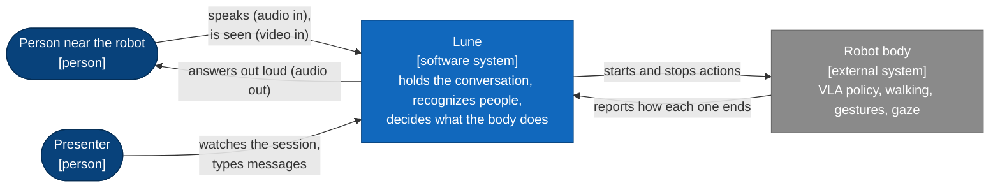
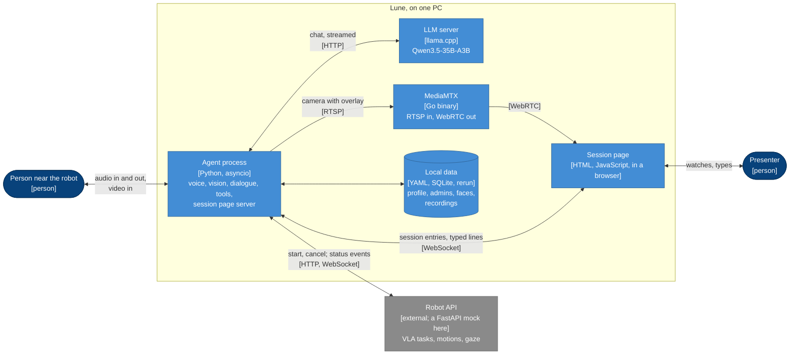
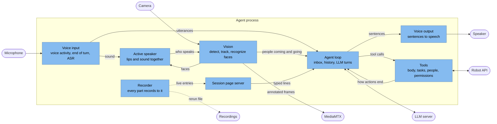
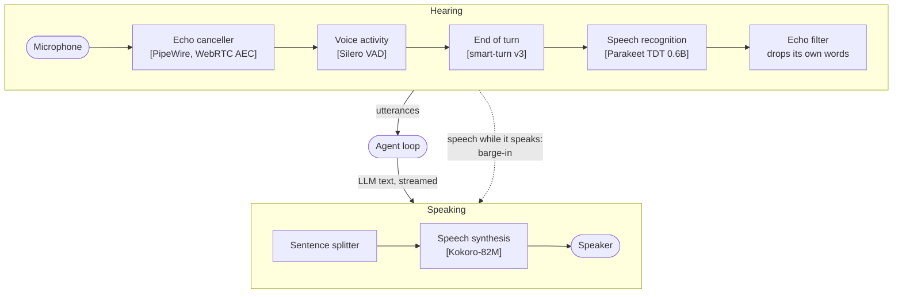
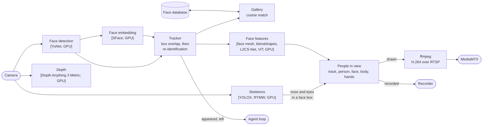
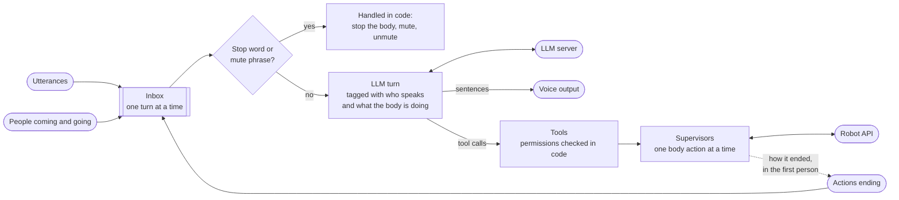
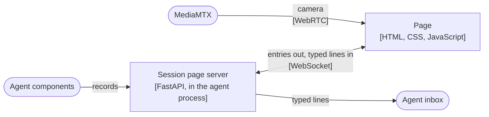
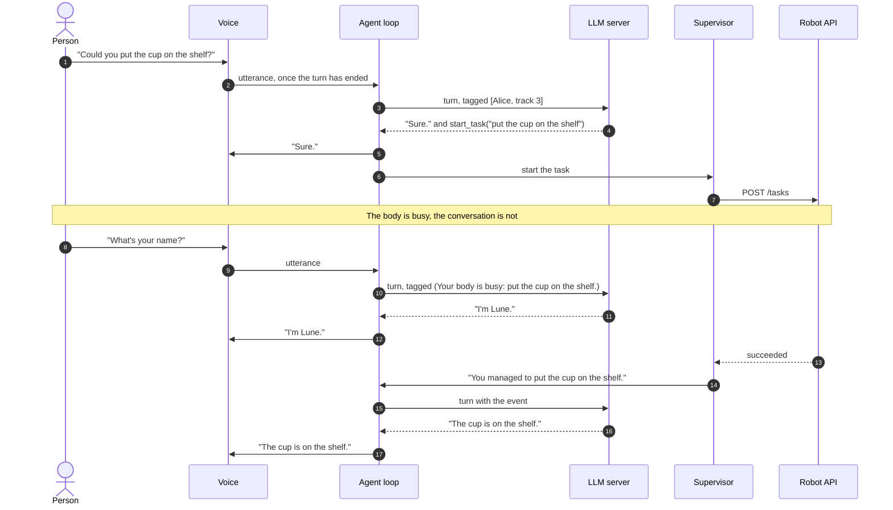
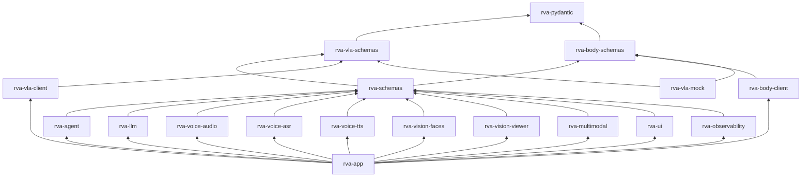

# Architecture

Lune is the high-level loop of a humanoid robot: it holds the conversation, keeps track of who is
around, and drives the body through a few long-running actions. A VLA policy and the robot's
controllers do the moving; Lune decides what to ask them. Three ideas shape the design: every
model runs locally, voice and vision feed one agent, and who may make the robot act is decided by
recognizing faces, in code.

This document zooms in step by step, following the [C4 model](https://c4model.com): the system and
what it talks to, the processes it runs as, the parts of the main process, and the code.

## 1. System context

Everything runs on one PC with one GPU (an RTX 4090 with 24 GB here); nothing calls a cloud API.
The robot body is reached through a small HTTP and WebSocket API, served for now by a mock.

## 2. Containers

| Container | Started with | Notes |
|---|---|---|
| Agent process | `lune run` (voice) or `lune text` (typing) | One asyncio loop; the camera has a thread of its own |
| LLM server | `lune serve-llm` | OpenAI-compatible API; another model is a config change |
| Robot API | `lune-mock` | Replace with the real robot's API |
| MediaMTX | `lune serve-video` | Only for the camera on the session page; downloaded on first use |
| Session page | `--ui`, then <http://127.0.0.1:8700> | Served by the agent process |
| Local data | paths in `runtime.yaml` | Profile, admins, face database, recordings; all but the profile outside the source tree |

`lune` runs them all: it starts each server that is not running yet, waits until it is ready
(for the LLM server, until its health check passes, since it answers while the model still
loads), runs the agent, and stops on exit what it started.

The profile is the robot's story (`character.yaml`, `environment.yaml`, `capabilities.yaml`,
rendered into the system prompt) plus the machine (`runtime.yaml`: models, devices, thresholds,
paths). `capabilities.yaml` matters most: the LLM should phrase VLA tasks the way the policy was
trained.

## 3. Inside the agent process

The agent loop depends only on interfaces (`typing.Protocol`s): where utterances come from, where
sentences go, the LLM, the robot, the camera, the recorder. The same loop runs with the voice
stack, with a terminal, or with the fakes the tests use.

### Voice

- **End of turn.** About 200 ms into a silence, smart-turn judges from the audio whether the
  sentence is finished; if not, Lune keeps listening, up to 1.5 s of silence.
- **Recognition on whole utterances.** The turn detector already says where an utterance ends,
  so a streaming ASR model is not needed: Parakeet takes about 6 ms per utterance.
- **Parakeet on TensorRT.** Its fp16 engines, built on first use, are tuned for one utterance of
  up to 20 s at a time; longer ones still work. That takes 1.9 GB where ONNX Runtime's CUDA
  provider took 3.8 GB, at 6 ms per utterance instead of 39, with the same transcripts. If TensorRT
  fails to load, starting fails rather than falling back to CUDA.
- **Speaking early.** LLM tokens are cut into sentences, and each goes to Kokoro as soon as it is
  complete while the previous one plays.
- **Barge-in.** Speech while Lune talks stops the playback and the LLM stream, and the history
  keeps only what was heard.
- **Not interrupting itself.** With speakers, three layers keep Lune from hearing its own voice:
  PipeWire subtracts what it plays from the microphone, a barge-in needs clearer and longer
  speech while it talks, and a transcript repeating what it said in the last 2 s is dropped.

### Vision

- **Per frame**, 1920x1080 at up to 30 fps: YuNet finds faces in about 6 ms; faces too small to
  be close are ignored. A new track gets an SFace embedding, then one every second until it is
  recognized.
- **Tracking.** A face keeps its track number across frames by box overlap, and across a quick
  move or occlusion by embedding. It is announced after 0.5 s in view and said to have left after
  3 s out of view.
- **Recognition.** A track is someone when its embeddings match that person's closely enough and
  clearly better than anyone else's. Once recognized, a track keeps its person while it lives and
  is no longer embedded: a continuous track is the same face, so the name does not flicker and
  the embedder rests. A person already on a track is not given to another one. Every track is
  matched again when the known people change: someone is named, renamed or forgotten. The largest
  face is taken as the person in front of the robot, and as whoever is speaking.
- **Memory.** The database is pseudonymous: people are user ids, names sit in a table of their
  own, and embeddings, operators and admins refer to ids only. No image is stored.
- **Face features**, on every face detected in the frame: MediaPipe's face mesh (478 points,
  irises included) on a crop levelled on the eyes; MediaPipe's blendshapes on those points, for
  how open each eye and the mouth are; L2CS-Net (Gaze360) for where the eyes point, 0 degrees
  being the camera; a ViT fine-tuned on FER2013 for one of seven expressions. They are meant for
  turn-taking (is the user looking at the robot, is their mouth moving) and are not yet given to
  the agent.
- **Main user and eye contact.** The main user is the most prominent face: its height, less the
  farther it is from the middle of the image, down to nothing at the edges. Another face takes over
  only once it scores a quarter higher, so two people side by side do not swap at every frame.
  Their gaze's angle off the camera is the median over the last 0.4 s, so a blink or a bad frame
  passes; eye contact starts under 12 degrees and ends over 18, so it does not flicker at the edge
  (`face_features.eye_contact`). L2CS-Net only sees the face's crop, and its angles turn out to be
  taken from the line between the face and the camera, not from the camera's axis: in a recording
  with the face from 28 degrees left of the axis to 32 right, its yaw moved 0.06 degrees per degree
  the face did. So 0 degrees is the camera wherever the face is, and no correction for the face's
  position is needed while the camera is the robot's eye. Its bias depends on the person: looking
  into the lens from both edges, one person read about +7 degrees of yaw (towards the right of the
  image) with glasses and +1.5 without. So no offset is taken off; the thresholds absorb it.
  Rules rather than a model, until recordings show where they fail.
  Shown in the debug window only for now.
- **Lips moving.** The main user's lips move as in speech while the gap between the
  inner lips over the mouth's width, from the face mesh, has a standard deviation over the last
  0.4 s above 0.03, then until it falls under 0.015 (`face_features.lip_motion`). Motion rather than
  opening, so a mouth held open does not count, and the window bridges the pauses between words.
  In a recording of talking with pauses, the motion was 0.05 to 0.10 while talking and under 0.007
  in between; a 0.4 s window found the same stretches of speech as a 0.8 s one, each ending 0.3 s
  sooner, which matters for turn-taking, while 0.3 s split them apart.
  The lips rather than the jaw-open blendshape, which barely moves when only the lips do; still,
  the face resting reads about 0.003. It cannot tell speech from chewing, laughing or mouthing
  words, nor whose voice is heard: the active speaker does.
- **Active speaker: where camera and microphone meet.** Light-ASD (CVPR 2023, MIT) tells which
  face speaks from its lips and the sound together: about a million parameters, 94.1% mAP on
  AVA-ActiveSpeaker, against 92.3% for TalkNet and 95.2% for LoCoNet, which is several times
  larger. Vision and audio each run on their own; they meet in `rva-multimodal`, behind the
  `SpeakerDetector` protocol, so vision never imports audio code. The microphone hands it each
  512-sample frame, stamped in the audio thread; the frame loop hands it each frame and the
  tracked faces' boxes, and it runs alongside the face models, 2.4 ms a frame on the GPU. It keeps
  the last second of each face, cropped and resampled to 25 fps as the model was trained, and of
  the sound, as MFCC. Its two GRUs read the window both ways, so the newest frame, with nothing
  after it, scores low: the frame 0.12 s before it is scored, and the thresholds sit at -1.0 to
  start and -1.3 to stop, below the model's own 0 (`active_speaker`). On a 60 s take of talking
  with pauses, scored frame by frame as it runs live, it agreed with Silero VAD on 95.8% of frames
  (1.3% speaking while the VAD heard nothing, 2.9% missed), where the lips-moving rule agreed on
  76%: the rule fired on lips moving silently and missed speech with little lip motion. The
  thresholds were tuned on that same take. There is no ONNX export of Light-ASD to download, so
  its pinned checkpoint is converted on first use, in a process of its own, as only that needs
  PyTorch (the `export` dependency group); the network is vendored for it, with the one change
  ONNX needs. `lune sense` runs it with the camera alone; `lune run` too. It is shown and recorded,
  not yet used for turn-taking.
, RTMW places the 133 COCO-WholeBody keypoints on each; the upper
  body (head, shoulders, elbows, wrists and hips) and both hands (21 points each) are kept. Legs and
  feet are left out: gestures need the arms, and RTMW would place a foot on a raised hand. The face
  is the mesh's job. With a hand held up close and no arm in view, RTMW can find both hands on it;
  the weaker, often mirrored, is dropped. Body points that no chain of found bones links to the
  head, shoulders or hips, such as a wrist whose elbow is out of frame, are dropped too, and so are
  hand points not linked to their wrist. Each finger is drawn in its own color, warm for the right
  hand and cool for the left. A skeleton belongs to the face track whose box holds its nose and
  eyes; the others, people turned away or too far to track, are kept apart. They run on a second
  thread while the faces are processed. They are meant for gestures: waving, a handshake, a fist
  bump.
- **Depth.** Depth Anything 3 Metric-Large (Apache-2.0) estimates the distance of every pixel from
  the camera image alone, alongside the skeletons. Its export takes a fixed 504x504 square, so the
  frame is letterboxed into it, keeping one focal length for both axes. The network predicts depth
  for a camera of its own focal length; the camera's intrinsics (`camera.intrinsics`, a file in
  the profile) scale it to this camera. The C920's are assumed from its datasheet until it is
  calibrated, and the depth is marked uncalibrated meanwhile. Unscaled, it was 1.2 to 1.4 times
  too far at desk distance; the assumed focal length scales it by a further 1.19. It is
  only shown, in the debug window, and is meant to place the skeletons in 3D. `--no-depth`, or
  `depth: null` in the profile, leaves it out.
- **Debug window.** `lune see`, and `--show` on the agent, open a Dear PyGui window: the camera
  with the overlay, and beside it each person's eyes, mouth, gaze, expression and skeleton, with
  a plot of how open each mouth has been. Right of the camera, its depth, with the distance under the
  mouse and whether the camera is calibrated. Underneath, a timeline of the main user's signals,
  one lane each, the last 30 s: eye contact, lips moving and speaking. It lives in its own package behind the `FrameViewer`
  protocol, so the camera pipeline runs without it, as on the robot.
- **One tree per person.** Each frame records every track with its person, face features,
  skeleton and hands: drawn over the camera image, and in rerun under `camera/people/<track>`,
  with eyes, mouth, gaze and the active speaker's score plotted under `people/<track>`.

### Agent loop and tools

**Every body action is a long-running tool call.** It returns as soon as the action starts; the
action can be asked about and cancelled, and its end comes back through the inbox for the LLM to
react to. Lune keeps talking meanwhile. Actions that hold the body exclude each other, and a
second one is refused rather than queued:

| Part | Tools | Runs | Who may |
|---|---|---|---|
| Body | `start_task` (VLA), `go_to_location`, `go_to_human`, `play_animation` | One at a time | Operators for tasks and walking; anyone for gestures |
| Body control | `stay`, `cancel_task`, `get_task_status` | Instant | Anyone |
| Head | `look_at_user`, `stop_look_at_user` | Alongside the body | Anyone |
| People | `who_is_here`, `remember_person`, `rename_person`, `forget_person`, `list_operators` | Instant | Anyone |
| Permissions | `authorize_person`, `revoke_person` | Instant | Operators |

- **Operators** are the admins, listed in a file of the machine, and the people an operator
  authorized by voice. They are only obeyed while the camera recognizes them as the face in
  front. The tools check this themselves, so a slip of the LLM cannot bypass it. Without a camera
  nobody can be recognized, so anyone may make the robot act.
- **What must always work is handled in code.** "Stop" stops the body, and "stop talking" mutes
  Lune until an operator lets it talk again, without asking the LLM: as a tool, muting failed
  in a real session.
- **Guidance goes where the model reads it.** The LLM follows the text of a turn far more than
  rules in its system prompt. So each user turn says who is speaking and what the body is busy
  with; a person arriving in front of the robot comes with "greet them"; and an action's end is
  told as Lune's own ("You could not pick up the red cup: the grasp slipped. Say it as your own
  failure."). Replaying a real session, that last hint took replies like "the task failed" from
  8 in 10 to none.
- **Initiative.** Lune looks at people and gestures on its own, but starts tasks and walks only
  when asked.
- **History.** One session's messages, trimmed from the oldest when the context fills; the
  system prompt always stays.

### Session page

- **The agent is the only reporter.** The page is one more recorder: it gets the same entries as
  the rerun recording, and a page opened mid-session first gets the whole session so far. The
  agent follows the robot's own status streams, so what the page shows running is the robot's
  real state.
- **What it shows.** The camera with boxes, names and the last sentence under the speaker's
  face; the conversation, sentence by sentence as Lune speaks, with each tool call and how
  actions end; and the actions board, where whatever holds the body glows and the actions it
  excludes are dimmed.
- **Typed lines** join the microphone's and are attributed to the face in front, like speech.
- **Plain HTML served by the agent**, rather than a Streamlit app: entries are pushed as they
  happen, with no polling and nothing to build.

### Robot API

The mock serves what a real robot would: VLA tasks, and the body's motions and gaze. Every call
is logged in its terminal.

| Endpoint | Purpose |
|---|---|
| `POST /tasks`, `POST /tasks/{id}/cancel`, `GET /tasks/{id}` | Start a VLA task from an instruction, cancel it, read it; 409 while the body is busy |
| `WS /events` | Task status changes: running, succeeded, failed (with a cause and a reason), cancelled |
| `POST /body/motions`, `POST /body/motions/{id}/cancel`, `POST /body/stay` | Walk to a place or a person, play an animation, stop |
| `PUT`, `DELETE /body/gaze`; `GET /body/state` | Follow a person with the gaze, or stop; what the body is doing |
| `WS /body/events` | Motion status changes |

Tasks take 5 s to 2 min, walking 5 to 30 s, animations 2 to 8 s, and some fail or time out at
random. With `--interactive`, typing `s`, `f <reason>` or `t` ends the running action instead.

## A turn, end to end

## 4. Code

The repository is one uv workspace. Each domain has a schemas package with its data types and its
interfaces, and implementations depend on the schemas, never on each other. Only `rva-app`
imports implementations: it is the composition root.

| Package | Contents |
|---|---|
| `rva-schemas` | Shared data types (dialogue, profile, faces, records) and the agent's interfaces |
| `rva-vla-schemas`, `rva-body-schemas` | The robot API's data types and client interfaces |
| `rva-agent` | Agent loop, history, system prompt, tools, supervisors, permissions |
| `rva-llm` | The LLM client over the OpenAI API, and llama-server's launch settings |
| `rva-voice-audio`, `-asr`, `-tts` | Microphone and speaker, VAD, end of turn, barge-in; Parakeet; Kokoro |
| `rva-vision-faces` | Camera, face detection, tracking and recognition, face features, skeletons, depth, face database, camera stream |
| `rva-vision-viewer` | Debug window for the camera pipeline, with Dear PyGui; vision runs without it |
| `rva-multimodal` | Where camera and microphone meet: which face speaks, with Light-ASD |
| `rva-ui` | Session page server and page; MediaMTX's launch settings |
| `rva-observability` | Logging, OpenTelemetry spans and the rerun recorder |
| `rva-vla-client`, `rva-body-client` | HTTP and WebSocket clients of the robot API |
| `rva-vla-mock` | The mock robot |
| `rva-app` | Command line, runtime configuration, wiring |

[AGENTS.md](../AGENTS.md) lists the conventions the code follows.

## Models

| Task | Model | Runs on |
|---|---|---|
| Voice activity | Silero VAD v6.2 | CPU |
| End of turn | smart-turn v3 | CPU |
| Speech recognition | Parakeet TDT 0.6B v2, English | GPU, fp16 on TensorRT, about 1.5 GB |
| Dialogue and tools | Qwen3.5-35B-A3B, Q4_K_M | GPU, about 16 GB; some expert layers on the CPU |
| Speech synthesis | Kokoro-82M, voice `af_heart` | GPU, about 1 GB |
| Face detection and embeddings | YuNet, SFace | GPU, under 0.8 GB with the camera pipeline |
| Face features | MediaPipe face mesh and blendshapes, L2CS-Net, ViT (FER2013) | GPU |
| Skeletons | YOLOX-L, RTMW-L 256x192 | GPU; with the face features, 1.7 GB more |
| Depth | Depth Anything 3 Metric-Large, fp16, 504x504 | GPU, about 22 ms and 1.4 GB alone |
| Active speaker | Light-ASD, AVA checkpoint, 1 s windows | GPU, about 2.4 ms a frame |

**Why a cascade.** Speech-to-speech models such as Kyutai's Moshi reason over audio: they have no
text history to edit, no tool calls and no system prompt of your own, which an agent driving a
robot needs.

**Why this LLM.** Qwen3.5-35B-A3B is a mixture of experts with about 3B parameters active per
token, so it answers much faster than a dense model of similar quality. It does not fit beside
the voice models at Q4_K_M, so llama.cpp keeps some expert layers in system RAM, run by the CPU.
Thinking is off: the turns are short and latency matters more.

## Observability

Each session gets a directory under `~/Captures/robot-voice-agent/`, with a rerun recording and
the log. The recording holds the dialogue, every tool call, the actions as they start and end,
people coming and going, and every tracked person with their face features and skeleton, with
`--video` the camera frames under them. Durations are OpenTelemetry spans, drawn as plots in the same recording: each turn,
the LLM call with its time to the first text, the speech with its time to the first audio, ASR,
each tool, and the vision steps.

## Measured

On the RTX 4090 and a Ryzen 9 7950X3D:

- From the end of the user's speech to Lune's first audio: 0.72 to 0.86 s.
- LLM: about 120 tokens/s; first token in 110 to 175 ms, first sentence in 180 to 330 ms.
- Parakeet about 6 ms per utterance on TensorRT (39 ms and 3.4 GB on ONNX Runtime's CUDA provider), Kokoro about 100 ms per sentence, smart-turn about 35 ms.
- GPU memory for the whole stack: 21 of 24 GB.
- Vision: about 6 ms per frame for detection; with one face, its features take about 13 ms and the
  skeletons, run alongside, about 16 ms, so it still follows the camera at 24 to 30 fps.
- Through the speakers with echo cancellation, Lune finished a five-sentence paragraph without
  interrupting itself. Without echo cancellation, it cut itself off in the first sentence.
