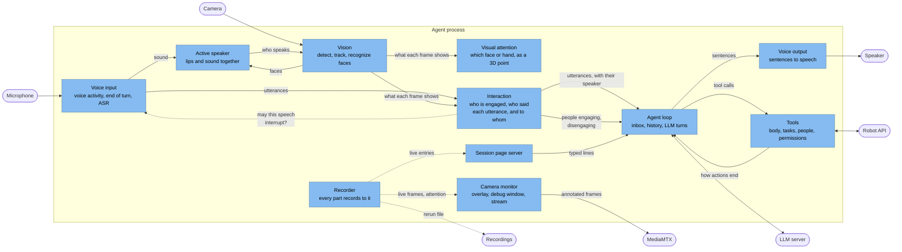
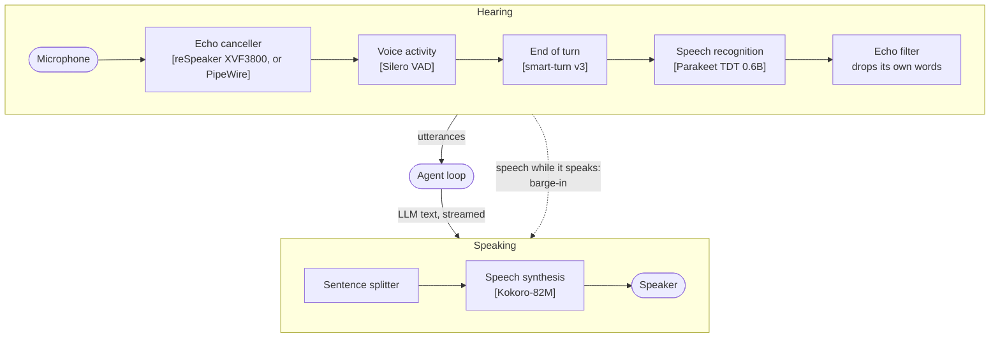
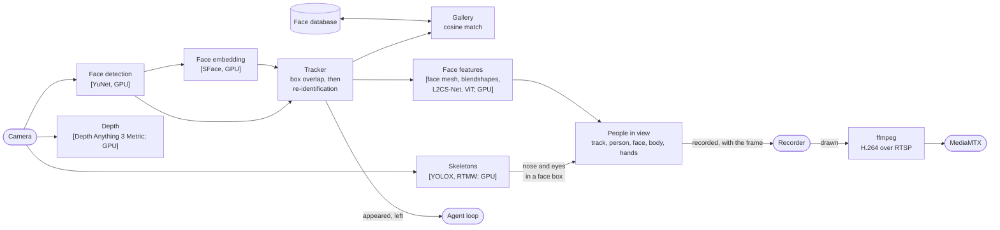
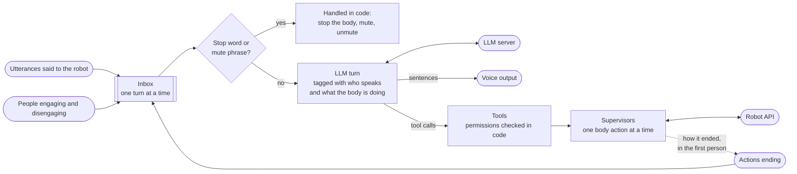
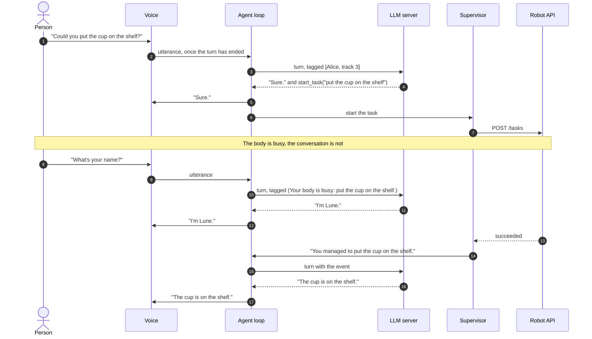
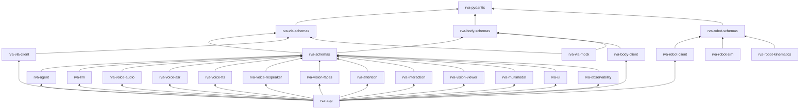

# Architecture

Lune is the high-level loop of a humanoid robot: it holds the conversation, keeps track of who is
around, and drives the body through a few long-running actions. A VLA policy and the robot's
controllers do the moving; Lune decides what to ask them. Three ideas shape the design: every
model runs locally, voice and vision feed one agent, and who may make the robot act is decided by
recognizing faces, in code.

This document zooms in step by step, following the [C4 model](https://c4model.com): the system and
what it talks to, the processes it runs as, the parts of the main process, and the code.

## 1. System context

Everything runs on one PC with one GPU (an RTX 4090 with 24 GB here); nothing calls a cloud API.
The robot body is reached through a small HTTP and WebSocket API, served for now by a mock.

## 2. Containers

| Container | Started with | Notes |
|---|---|---|
| Agent process | `lune run` (voice) or `lune text` (typing) | One asyncio loop; the camera has a thread of its own |
| LLM server | `lune serve-llm` | OpenAI-compatible API; another model is a config change |
| Robot API | `lune-mock` | Replace with the real robot's API |
| Simulated robot | `lune-sim` | A Reachy Mini in Genesis with people around: joints and head camera over kickmsg; the camera of the `reachy_mini_sim` profile |
| MediaMTX | `lune serve-video` | Only for the camera on the session page; downloaded on first use |
| Session page | `--ui`, then <http://127.0.0.1:8700> | Served by the agent process |
| Local data | paths in `runtime.yaml` | Profile, admins, face database, recordings; all but the profile outside the source tree |

`lune` runs them all: it starts each server that is not running yet, waits until it is ready
(for the LLM server, until its health check passes, since it answers while the model still
loads), runs the agent, and stops on exit what it started.

The profile is the robot's story (`character.yaml`, `environment.yaml`, `capabilities.yaml`,
rendered into the system prompt) plus the machine (`runtime.yaml`: models, devices, thresholds,
paths). `capabilities.yaml` matters most: the LLM should phrase VLA tasks the way the policy was
trained.

## 3. Inside the agent process

The agent loop depends only on interfaces (`typing.Protocol`s): where utterances come from, where
sentences go, the LLM, the robot, the camera, the recorder. The same loop runs with the voice
stack, with a terminal, or with the fakes the tests use.

### Voice

- **End of turn.** About 200 ms into a silence, smart-turn judges from the audio whether the
  sentence is finished; if not, Lune keeps listening, up to 1.5 s of silence.
- **Recognition on whole utterances.** The turn detector already says where an utterance ends,
  so a streaming ASR model is not needed: Parakeet takes about 6 ms per utterance.
- **Parakeet on TensorRT.** Its fp16 engines, built on first use, are tuned for one utterance of
  up to 20 s at a time; longer ones still work. That takes 1.9 GB where ONNX Runtime's CUDA
  provider took 3.8 GB, at 6 ms per utterance instead of 39, with the same transcripts. If TensorRT
  fails to load, starting fails rather than falling back to CUDA.
- **Speaking early.** LLM tokens are cut into sentences, and each goes to Kokoro as soon as it is
  complete while the previous one plays.
- **Barge-in.** Speech while Lune talks stops the playback and the LLM stream, and the history
  keeps only what was heard.
- **Not interrupting itself.** With speakers, three layers keep Lune from hearing its own voice:
  the echo canceller subtracts what it plays from the microphone, a barge-in needs clearer and
  longer speech while it talks, and a transcript repeating what it said in the last 2 s is
  dropped.
- **Echo cancellation on the microphone array.** The reSpeaker XVF3800 cancels the echo on its
  chip, against what it plays from its own jack, so Lune listens and speaks through it, and gets
  the array's beamforming and noise suppression too. Its stock USB firmware runs at 16 kHz,
  which cut Kokoro's voice off at 8 kHz and sounded clearly worse; Seeed's 48 kHz firmware plays
  tones up to 14 kHz through the jack, and the chip still cancels them. Capture is still
  processed at 16 kHz inside the chip, which is the rate the ASR wants anyway. With another
  microphone, PipeWire's WebRTC canceller does it between `rva_ec_sink` and `rva_ec_source`.

### Vision

- **Per frame**, 1920x1080 at up to 30 fps: YuNet finds faces in about 6 ms; faces too small to
  be close are ignored. A new track gets an SFace embedding, then one every second until it is
  recognized.
- **Tracking.** A face keeps its track number across frames by box overlap, and across a quick
  move or occlusion by embedding. It is announced after 0.5 s in view and said to have left after
  3 s out of view.
- **Recognition.** A track is someone when its embeddings match that person's closely enough and
  clearly better than anyone else's. Once recognized, a track keeps its person while it lives and
  is no longer embedded: a continuous track is the same face, so the name does not flicker and
  the embedder rests. A person already on a track is not given to another one. Every track is
  matched again when the known people change: someone is named, renamed or forgotten. The largest
  face is taken as the person in front of the robot.
- **Memory.** The database is pseudonymous: people are user ids, names sit in a table of their
  own, and embeddings, operators and admins refer to ids only. No image is stored.
- **Face features**, on every face detected in the frame: MediaPipe's face mesh (478 points,
  irises included) on a crop levelled on the eyes; MediaPipe's blendshapes on those points, for
  how open each eye and the mouth are; L2CS-Net (Gaze360) for where the eyes point, 0 degrees
  being the camera; a ViT fine-tuned on FER2013 for one of seven expressions. They are meant for
  turn-taking (is the user looking at the robot, is their mouth moving) and are not yet given to
  the agent.
- **Main user and eye contact.** The main user is the most prominent face: its height, less the
  farther it is from the middle of the image, down to nothing at the edges. Another face takes over
  only once it scores a quarter higher, so two people side by side do not swap at every frame.
  Their gaze's angle off the camera is the median over the last 0.4 s, so a blink or a bad frame
  passes; eye contact starts under 12 degrees and ends over 18, so it does not flicker at the edge
  (`face_features.eye_contact`). L2CS-Net only sees the face's crop, and its angles turn out to be
  taken from the line between the face and the camera, not from the camera's axis: in a recording
  with the face from 28 degrees left of the axis to 32 right, its yaw moved 0.06 degrees per degree
  the face did. So 0 degrees is the camera wherever the face is, and no correction for the face's
  position is needed while the camera is the robot's eye. Its bias depends on the person: looking
  into the lens from both edges, one person read about +7 degrees of yaw (towards the right of the
  image) with glasses and +1.5 without. So no offset is taken off; the thresholds absorb it.
  Rules rather than a model, until recordings show where they fail.
  Shown in the debug window only for now.
- **Lips moving.** The main user's lips move as in speech while the gap between the
  inner lips over the mouth's width, from the face mesh, has a standard deviation over the last
  0.4 s above 0.03, then until it falls under 0.015 (`face_features.lip_motion`). Motion rather than
  opening, so a mouth held open does not count, and the window bridges the pauses between words.
  In a recording of talking with pauses, the motion was 0.05 to 0.10 while talking and under 0.007
  in between; a 0.4 s window found the same stretches of speech as a 0.8 s one, each ending 0.3 s
  sooner, which matters for turn-taking, while 0.3 s split them apart.
  The lips rather than the jaw-open blendshape, which barely moves when only the lips do; still,
  the face resting reads about 0.003. It cannot tell speech from chewing, laughing or mouthing
  words, nor whose voice is heard: the active speaker does.
- **Active speaker: where camera and microphone meet.** Light-ASD (CVPR 2023, MIT) tells which
  face speaks from its lips and the sound together: about a million parameters, 94.1% mAP on
  AVA-ActiveSpeaker, against 92.3% for TalkNet and 95.2% for LoCoNet, which is several times
  larger. Vision and audio each run on their own; they meet in `rva-multimodal`, behind the
  `SpeakerDetector` protocol, so vision never imports audio code. The microphone hands it each
  512-sample frame, stamped in the audio thread; the frame loop hands it each frame and the
  tracked faces' boxes, and it runs alongside the face models, 2.4 ms a frame on the GPU. It keeps
  the last second of each face, cropped and resampled to 25 fps as the model was trained, and of
  the sound, as MFCC. Its two GRUs read the window both ways, so the newest frame, with nothing
  after it, scores low: the frame 0.12 s before it is scored, and the thresholds sit at -1.0 to
  start and -1.3 to stop, below the model's own 0 (`active_speaker`). On a 60 s take of talking
  with pauses, scored frame by frame as it runs live, it agreed with Silero VAD on 95.8% of frames
  (1.3% speaking while the VAD heard nothing, 2.9% missed), where the lips-moving rule agreed on
  76%: the rule fired on lips moving silently and missed speech with little lip motion. The
  thresholds were tuned on that same take. There is no ONNX export of Light-ASD to download, so
  its pinned checkpoint is converted on first use, in a process of its own, as only that needs
  PyTorch (the `export` dependency group); the network is vendored for it, with the one change
  ONNX needs. `lune sense` runs it with the camera alone; `lune run` too. It is shown, recorded, and tells
  who said each utterance and whose speech may interrupt Lune.
- **Skeletons.** YOLOX finds people, RTMW places the 133 COCO-WholeBody keypoints on each; the upper
  body (head, shoulders, elbows, wrists and hips) and both hands (21 points each) are kept. Legs and
  feet are left out: gestures need the arms, and RTMW would place a foot on a raised hand. The face
  is the mesh's job. Body points that no chain of found bones links to the head, shoulders or hips,
  such as a wrist whose elbow is out of frame, are dropped, and so are hand points not linked to
  their wrist. Each finger is drawn in its own color, warm for the right hand and cool for the left.
  A skeleton belongs to the face track whose box holds its nose and eyes, or, with no face seen
  there, whose box held them when the face was last seen: hands over the face, or a face blurred as
  it moves, keep the skeleton its person's. The others, people turned away or too far to track, are
  kept apart. Two skeletons with the same nose and eyes, within half the gap between the eyes, are
  one person found twice, the second box around a raised arm; the more confident is kept. A
  skeleton's two hands are one when they overlap by half or their wrists are within a quarter of a
  hand: RTMW puts both hands on the one it sees, shifted or mirrored, and the hand kept is the one
  whose wrist meets its arm's. A tracked person's hand is shown from its second frame in a row: in
  recordings, most hands found in a single frame were such doubles. Skeletons are found on a second
  thread while the faces are processed. They are meant for gestures: waving, a handshake, a fist
  bump.
- **Depth.** Depth Anything 3 Metric-Large (Apache-2.0) estimates the distance of every pixel from
  the camera image alone, alongside the skeletons. Its export takes a fixed 504x504 square, so the
  frame is letterboxed into it, keeping one focal length for both axes. The network predicts depth
  for a camera of its own focal length; the camera's intrinsics (`camera.intrinsics`, a file in
  the profile) scale it to this camera. The C920's are assumed from its datasheet until it is
  calibrated, and the depth is marked uncalibrated meanwhile. Unscaled, it was 1.2 to 1.4 times
  too far at desk distance; the assumed focal length scales it by a further 1.19. `--no-depth`,
  or `depth: null` in the profile, leaves it out.
- **People in 3D.** With depth and intrinsics, each face gets a gaze ray from between its irises,
  and the main user's skeleton and hands a position per keypoint, in the camera's frame (x right,
  y down, z forward, in metres). Only theirs: gestures are read from the main user alone, and a
  hand's fit is paid per hand, so a crowd in view costs nothing more. A keypoint's depth is the 25th percentile of a 5x5 patch of the depth map
  around it: keypoints sit on the edges of limbs and fingers, where the patch also holds the room
  behind, and the person is the nearer side. The gaze angles are measured from the line from the
  eyes to the camera, so the ray turns that line by the yaw towards the image's right and the
  pitch upwards. An occluded keypoint, a wrist behind the body, takes the occluder's depth.
  Fingers are too thin for the depth model, which sees the room through them, so hands are not read
  from the depth: a kinematic hand is fitted to their 21 keypoints in the image (`hand_model.py`).
  It is a rigid palm, the wrist and the base of each finger, with four joints per finger: the base
  bends and spreads, the two others only bend, each within a finger's range, so a finger cannot bend
  backwards. Its proportions are RTMW's: its palm measures about 1.45 times longer against the
  fingers than an anatomical one, on three hands of two people. The depth gives one number per hand,
  how far the wrist is: the depth of the arm's wrist, which the forearm holds, so that the two
  skeletons meet, or the palm's without it. With the wrist held there, the hand's turn, its size and
  its 20 angles are fitted by least squares to the keypoints, each weighing by its score, with a
  robust loss for a misplaced one, starting from the last fit and staying near it, or from a flat
  and a curled hand for a new one. The costs that hold the fit near the last frame and near its
  size are in pixels of the hand's palm, so a far hand, 70 pixels across, bends its fingers as
  freely as a near one. A fit from the last frame that leaves the keypoints far off, stuck where
  the hand was, is started afresh too, keeping the best. The last fit is kept for half a second
  while the hand is not seen, so a hand missed for a frame goes on from where it was. The size is
  held firmly near the median of the track's last 3 s, so it adapts over seconds but does not
  pulse: left free, the fit traded size for bends where keypoints are hard to explain, as a fist's,
  and swung it from 0.7 to 1.2 between frames. None is stored per person, as the depth and an
  uncalibrated camera measure it less well than adult hands differ, about 6%. A fit takes about 5
  to 7 ms per hand on a recording, 11 for a hand's first frame. A single image leaves some bends open, a finger
  curled towards the camera or away: the joint limits and the last frame decide.
- **TensorRT.** With `device: {kind: tensorrt}`, every vision model but YuNet runs as an fp16
  TensorRT engine, built on first use (about 7 minutes in all, depth the longest) and cached.
  Together they take 2.8 GB where ONNX Runtime's CUDA provider took 3.5 GB, and run two to three
  times faster: depth 7.5 ms instead of 18, YOLOX 2.0 instead of 6.5, RTMW 1.4 instead of 3.2,
  gaze 0.6 instead of 2.2. YuNet stays on CUDA: on the whole frame TensorRT takes it twice as long.
  The mesh, expression and pose engines take up to 8 faces or people at once; more rebuilds the
  engine, once, in about half a second. Thor's profile keeps CUDA, as TensorRT is not tried there.
- **The camera is shown by a consumer of the records**, not by the pipeline. Each frame, once
  what was seen in it is recorded, the pipeline records the frame itself as a `LiveFrame`, with
  the people in its pixels, its depth, the main user and the timings. The camera monitor
  (`rva-vision-viewer`) is a `Recorder` like rerun and the session page: it draws over the live
  frame the boxes, faces, skeletons, what was said, and the point of the last `AttentionState`
  it received, then shows the frame in the debug window, sends it to ffmpeg for the session page,
  or both. Nothing to show is routed back into the pipeline: a new signal is one more record for
  the monitor to draw. Live frames come in the camera's thread, which the window lives in; the
  window opens with the first frame and, closed, stays closed while the camera goes on.
- **Debug window.** `lune see`, and `--show` on the agent, open a Dear PyGui window: the camera
  with the overlay and, right of it, its depth, with the distance under the mouse and whether
  the camera is calibrated, and under the depth the attention: the score of every face and
  hand that could be attended to over the last 30 s, a curve each, the one attended to marked
  in the legend. Then the timings and checkboxes for what is drawn over the camera:
  skeletons, hands, faces (the outline of the eyes and lips, the irises and the gaze) and
  engagement; they hold for the stream too. Under the camera, once there is sound, how loud
  the microphone and the robot's voice were over the last 30 s, with the speech probability.
  Underneath, across the window, a row per person in
  view, for as long as their track lasts: their gaze, expression, skeleton and engagement in
  words, a timeline of the last 30 s with a lane each for looking at the robot, speaking and
  engaged and their engagement score as a line, and a plot of how open their eyes and mouth
  have been. The rows share their time axis, so who speaks when reads down them. The numbers of
  the face are no longer written over the image. It lives in the viewer package, which the
  camera pipeline never imports, so the pipeline runs without it, as on the robot.
- **One tree per person.** Each frame records every track with its person, face features,
  skeleton and hands: drawn over the camera image, and in rerun under `camera/people/<track>`,
  with eyes, mouth, gaze and the active speaker's score plotted under `people/<track>`. In 3D,
  the skeletons, hands and gaze rays are under `space/people/<track>`, in the camera's frame,
  which is the 3D view's; `camera` holds the camera's pinhole, so the image and its 2D overlay
  show in that view too. With `--video`, the depth is recorded under `depth`, as a point cloud
  around the people, every other pixel in millimetres.

### Visual attention

Which face or hand in view the robot attends to, as a point in the camera's frame, which the head
controller turns the head to (see the robot's section) when the profile has one. It is a package of its own, `rva-attention`, fed by the
vision loop and never importing it: one observation per frame, the people in view with the
frame's time and the main user's track, over a queue that keeps only the latest frame. Every
dynamic runs on the frames' times, so a recorded sequence gives the same states back, and the
core does no I/O.

- **Candidates** are the confirmed faces placed in 3D, at the point between the irises so the
  gaze meets the eyes, and the main user's hands at the centre of the palm; only theirs are
  placed in 3D. Skeletons without a face have neither a track nor a point, so they are left out.
- **Score.** Seven features from 0 to 1: closeness, centrality (the angle off the camera's axis),
  speaking (the active speaker), eye contact (the gaze's angle off the camera), moving (the speed
  along the path over the last 0.3 s, so a hand waving in place counts), known, and novelty,
  which is 1 as an entity appears and decays over a second or two. A hand has only its motion
  and its novelty. The score is their weighted mean, so from 0 to 1 whatever the weights, times
  the entity's habituation, which decays towards a floor while attended and recovers while not.
  So a newcomer is worth a glance, a wave draws the eye, and a hand's habituation is ten times
  faster than a face's so the wave yields to its owner's face within a couple of seconds.
  Everything is in the profile's `attention` section.
- **Selection** with hysteresis: the best candidate takes over only once the current target was
  attended for the minimum dwell and scores better by the margin. Below the minimum score nothing
  is attended: a still person far at the edge, once no longer new, is as good as nobody. The
  target must be in the frame: a face the mesh or the depth misses for a frame is held at its
  last pose for 0.3 s, longer than that it is dropped at once. Idle gazing around, when
  there is nothing, is not the attention's: something above will drive it.
- **Memory.** Entities outlive their last sighting by two seconds, with their poses, novelty and
  habituation, so a face lost for a few frames comes back as the same entity, without the bonus
  again; a known person back on a new track gets their old entity. Scenarios can later swap the
  scoring function; the dialogue and, with a microphone array, the sound will join the features.
- **Recorded** every frame: the target as a point under `space/attention` and over the camera
  image, and each candidate's score under `attention/<entity>/score`, e.g. `face_3` or
  `right_hand_3`. The camera monitor marks the target in the window and the stream, from the
  same record: a pair of eyes above the face's labels, or a little above a hand, looking down
  at the point. Nothing takes the target yet: the body API is to be
  redone around it.

### Interaction

Where perception meets the dialogue, in `rva-interaction`: who pays attention to the robot, which
face said an utterance, and whether they said it to the robot. Like the attention, it is fed one
observation per frame by the vision loop, runs on the frames' times and its parts do no I/O, so a
recording replays to the same decisions. The reflexes are scores with hysteresis here; what to
say about them is the LLM's. None of the thresholds is tuned on recordings of several people yet.

- **Engagement.** Each tracked face has a score from 0 to 1, from its first frame, and engages
  once confirmed. While they look at the robot (a
  gaze within 15 degrees of the camera) it rises towards closeness times staying: closeness is 1
  up to 2 m and falls to 0 at 4.5 m, staying is 1 standing still and 0 from a walking pace,
  measured straight between where the face was half a second ago and where it is, as its depth
  jitters. While they do not look it falls towards 0, more slowly: listeners look away. They are
  engaged from 0.6, after about 0.7 s of eye contact up close, down to 0.2, after about 5 s
  looking away; a track that ends has left at once. So someone walking past, glancing from afar
  or standing with their back turned is not engaged. Once engaged, speaking counts as looking:
  people look away to think. At most three are engaged at once. Without depth, any tracked face
  is taken as close and staying.
- **One clock.** The voice input stamps each utterance with when its speech started and ended on
  the monotonic clock the frames are stamped with: back from the frame that ended the turn by the
  length of its audio, and by the silence that ended it.
- **Who said it.** For each frame, the face the active speaker saw speaking is kept, at the
  moment it scored, 0.12 s before the frame, for the last 30 s. When it saw several, only the
  one it was surest of: it often sees a listener speak too, nodding or smiling along. In a
  replayed interview, two faces were each seen speaking in over half of the same frames. An
  utterance is said by the face seen speaking in the largest share of its frames, if that is at
  least 0.3: pauses between words count against the speaker. Otherwise nobody in view said it.
- **Where the speech comes from.** With the reSpeaker XVF3800, `rva-voice-respeaker` asks the
  chip 20 times a second for its two focused beams' azimuths and speech energies. Speech comes
  from the beam hearing the most of it, when its energy is above 0: 10^5 to 4·10^6 while someone
  talked, exactly 0 in a quiet room with a PC's fan. The chip's own direction of the speaker
  would be simpler, but it held 164 degrees for most of a second after the speech ended, with
  every energy at 0. The direction is sent in the array's own frame, named by its link, with the
  time it was heard: 60 ms before it is read, for the chip's processing. Each frame takes the last direction heard by its time, within
  0.2 s, turns it into the camera's frame through the profile's transform between the two links,
  and compares it, around the vertical, with each face's bearing from where its box is in the
  image. A face within 15 degrees of it may have said it. Among the faces seen speaking, those
  it comes from are preferred, whoever the active speaker is surest of: the listener who nods
  along is set apart from the talker, unless they stand in the same direction. Speech from out
  of view makes the frame nobody's in view, as lips moving in view are then a listener's. A face
  in view the speech comes from, and only that one, counts as speaking although its lips are not
  seen to: turned away, or hidden. When the speech comes from where no face is in view, the lips
  decide: a flat array of four mics 66 mm apart is too rough to overrule them. The array only
  helps the active speaker, so a profile with one must have the other. Directions are not in
  the recordings replayed with `lune listen --replay`.
- **Links.** What the camera sees names the camera's optical link, and each direction heard the
  array's link, so that both can be placed on the robot's description later. Until then, the
  profile's `transforms` fix one link to another, as a URDF joint's origin would; the links' names
  are placeholders.
- **One speaker per utterance.** People who talk on without a pause make one turn for the
  endpointer: in that interview, 70 s with three voices, which no single face said. So a turn is
  cut where the face speaking changes, and each piece is recognized and judged as an utterance
  of its own. A stretch under a second, a word thrown in, stays in the piece before it, and
  pauses stay with whoever spoke before them. The change is seen to a fraction of a second
  only, so the audio is cut at the quietest 20 ms within a quarter second of it, between two
  words. A turn also ends at 20 s whatever is said, within what the ASR engine takes; the
  speech that follows is the next turn.
- **Whether to the robot.** By the share of the utterance its speaker looked at the robot:
  someone engaged is trusted unless they faced someone else throughout (under 0.1); anyone else
  must look at it for most of it (0.5), and is engaged from then on. Someone engaged with no
  other face in view has nobody else to talk to, and is trusted wherever they look: they may
  well read the robot's screen. What is not said to the
  robot, or said by nobody in view, is dropped before the LLM, with a log line. A stop word while
  the body is busy is obeyed whoever says it.
- **Judged as it arrives**, by a `UserInput` wrapped around the voice input, so the agent only
  reads the speaker off the utterance. Typed lines, and utterances without an active speaker,
  are taken to be the face in front's, said to the robot.
- **Whose speech interrupts.** While someone is engaged, speech stops Lune's only once an engaged
  face is seen speaking; the voice input holds the barge-in back until then, and the turn is
  recognized either way. With nobody engaged, or `barge_in: anyone`, any speech does. A stop
  word cuts the reply off as soon as it is recognized, before its turn comes.
- **Permissions are not the speaker's yet**: tools still check that the face in front is an
  operator, whoever spoke.
- **Recorded** every frame: each person's score under `engagement/track_<n>/score`, and the
  events. The camera monitor writes each person's score on their label and doubles the box of
  an engaged one, in the window and the stream; the window plots it per person. `lune see` and `lune sense` log people engaging and disengaging; `lune listen --camera`
  prints each turn with who said it and whether to the robot.
- **Replayed from a video file**, with `lune listen --replay`: the file's frames stand in for
  the camera, fitted into its size, and its sound, decoded by ffmpeg, for the microphone. Both
  run at the file's pace from its first frame, on the monotonic clock, and frames that come due
  while one is processed are skipped, as a camera's are. So the same people can be heard again
  after a threshold changes. Distances are only rough: the depth is scaled for the robot's
  camera, not the one that filmed.

### Agent loop and tools

**Every body action is a long-running tool call.** It returns as soon as the action starts; the
action can be asked about and cancelled, and its end comes back through the inbox for the LLM to
react to. Lune keeps talking meanwhile. Actions that hold the body exclude each other, and a
second one is refused rather than queued:

| Part | Tools | Runs | Who may |
|---|---|---|---|
| Body | `start_task` (VLA), `go_to_location`, `go_to_human`, `play_animation` | One at a time | Operators for tasks and walking; anyone for gestures |
| Body control | `stay`, `cancel_task`, `get_task_status` | Instant | Anyone |
| Head | `look_at_user`, `stop_look_at_user` | Alongside the body | Anyone |
| People | `who_is_here`, `remember_person`, `rename_person`, `forget_person`, `list_operators` | Instant | Anyone |
| Permissions | `authorize_person`, `revoke_person` | Instant | Operators |

- **Operators** are the admins, listed in a file of the machine, the people an operator
  authorized by voice, and the first person a robot with an empty face database learns the name
  of: whoever meets a fresh robot first is who set it up, and without them nobody could authorize
  anyone where no admin is listed. They are only obeyed while the camera recognizes them as the face in
  front, but what they started runs to its end: in the turn that answers the end of a task or a
  walk, the next step may start whoever is in front, or nobody, since only an operator could
  have had the first one started. The tools check this themselves, so a slip of the LLM cannot
  bypass it. Without a camera
  nobody can be recognized, so anyone may make the robot act.
- **What must always work is handled in code.** "Stop" stops the body, and "stop talking" mutes
  Lune until an operator lets it talk again, without asking the LLM: as a tool, muting failed
  in a real session.
- **Guidance goes where the model reads it.** The LLM follows the text of a turn far more than
  rules in its system prompt. So each user turn says who is speaking and what the body is busy
  with; a person engaging comes with "greet them"; and an action's end is
  told as Lune's own ("You could not pick up the red cup: the grasp slipped. Say it as your own
  failure."). Replaying a real session, that last hint took replies like "the task failed" from
  8 in 10 to none.
- **Initiative.** Lune looks at people and gestures on its own, but starts tasks and walks only
  when asked.
- **People.** The LLM hears of people when they engage, not when a face is detected: an engaged
  person is greeted, once per track, and a known one not again within `regreet_after_s`. Faces
  coming and going are only recorded; `who_is_here` lists them.
- **A listener lost.** A reply to one person stops after the sentence being said once they are
  no longer engaged, if they were as it started. The history keeps what was heard and why it
  stopped; when they engage again, the LLM gets a turn to pick it up or let it go.
- **History.** One session's messages, trimmed from the oldest when the context fills; the
  system prompt always stays.

### Session page

- **The agent is the only reporter.** The page is one more recorder: it gets the same entries as
  the rerun recording, and a page opened mid-session first gets the whole session so far. The
  agent follows the robot's own status streams, so what the page shows running is the robot's
  real state.
- **What it shows.** The camera with boxes, names and the last sentence under the speaker's
  face; the conversation, sentence by sentence as Lune speaks, with each tool call and how
  actions end; and the actions board, where whatever holds the body glows and the actions it
  excludes are dimmed.
- **Typed lines** join the microphone's and are attributed to the face in front.
- **Plain HTML served by the agent**, rather than a Streamlit app: entries are pushed as they
  happen, with no polling and nothing to build.

### Robot API

The mock serves what a real robot would: VLA tasks, and the body's motions and gaze. Every call
is logged in its terminal.

| Endpoint | Purpose |
|---|---|
| `POST /tasks`, `POST /tasks/{id}/cancel`, `GET /tasks/{id}` | Start a VLA task from an instruction, cancel it, read it; 409 while the body is busy |
| `WS /events` | Task status changes: running, succeeded, failed (with a cause and a reason), cancelled |
| `POST /body/motions`, `POST /body/motions/{id}/cancel`, `POST /body/stay` | Walk to a place or a person, play an animation, stop |
| `PUT`, `DELETE /body/gaze`; `GET /body/state` | Follow a person with the gaze, or stop; what the body is doing |
| `WS /body/events` | Motion status changes |

Tasks take 5 s to 2 min, walking 5 to 30 s, animations 2 to 8 s, and some fail or time out at
random. With `--interactive`, typing `s`, `f <reason>` or `t` ends the running action instead.

### Simulated robot

Below the robot API are the joints and the camera, which visual servoing needs. `lune-sim` runs a
Reachy Mini on a table in [Genesis](https://genesis-world.readthedocs.io), in a process of its own,
and serves them over [kickmsg](https://pypi.org/project/kickmsg/), a lock-free shared-memory
pub/sub: any process of the machine can read the joints and the camera, and send position
targets.

| Topic | Kind | Content |
|---|---|---|
| `joint_state` | Published by the robot, 100 Hz | Position and velocity of each actuated joint, as JSON |
| `camera` | Published by the robot, 30 Hz | The head camera's BGR frame, 1280×720, after a small binary header |
| `joint_command` | Mailbox of the robot | Position targets for some joints, as JSON; the others keep theirs |
| `head_target` | Mailbox of the head controller | A head pose, as JSON; the controller takes the latest |
| `gaze_target` | Mailbox of the head controller | A point in the head camera's frame and when it was seen, as JSON; the controller takes the latest |
| `person_pose` | Mailbox of the simulation's own node, `sim` | Where one of the simulated people stands, as JSON |

- **The MJCF, not the URDF.** Reachy Mini's head sits on a Stewart platform: six motors whose rods
  close on the head. The MJCF closes those loops with equality constraints, which Genesis
  follows; the URDF can only describe them as an open tree. Pollen ships both in their
  `reachy-mini` package, and no official Hugging Face repository holds them, so the simulation
  downloads that wheel from PyPI on first use, checks it against PyPI's digest and keeps only the
  MJCF and its meshes: nothing of the robot is committed but the kinematic tree the kinematics'
  tests read, and Pollen's SDK is not installed.
- **The joints are the motors.** The nine actuated joints are exposed as they are: the body's yaw,
  the six Stewart motors and the two antennas. Turning a head pose into motor angles is the
  controller's job, not the simulation's.
- **Genesis on the CPU, the camera on the GPU.** For one environment, the CPU backend steps faster
  than the GPU launches kernels: a step takes about 0.15 ms. The head camera is a sensor fixed to
  the head's link, rendered by [Nyx](https://github.com/Genesis-Embodied-AI/nyx-for-genesis),
  Genesis' path tracer, in about 4 ms at 1280×720, only when a frame is due. Nyx drives the GPU
  through torch, which is why the workspace has torch's CUDA build. Genesis' rasterizer
  (`kind: rasterizer` in `sim.yaml`) needs no ray-tracing GPU, for the tests and other machines.
- **People to look at.** Microsoft's [Rocketbox](https://github.com/microsoft/Microsoft-Rocketbox)
  avatars, MIT-licensed, with photographed faces that the face detector takes: `sim.yaml` places
  them, facing the robot or turned away. On first use each one is downloaded from GitHub at a
  pinned commit and baked once by headless Blender into a static GLB, since Genesis cannot read
  their FBX: the most detailed mesh, without its skeleton, in its A-pose. RenderPeople's scans look
  more real, but their terms forbid computer vision use without written consent; Objaverse's
  scans each need their own fixes. They are the simulation's NPCs: the `npc` CLI moves them
  while it runs, through the `person_pose` mailbox of the simulation's own node, without loading
  Genesis. `npc walk` paces one sideways across the robot's view, back and forth at a steady
  speed, to watch the head follow. The roadmap has the layers the simulation is to be split into:
  scene, robots, NPCs and scenarios.
- **A room around them.** With Nyx, an HDRI from [Poly Haven](https://polyhaven.com/hdris) (CC0)
  is seen around the world and lights it, with a sun for shadows; downloaded on first use and
  checked against Poly Haven's MD5.
- **kickmsg rather than zenoh.** Everything runs on one machine, and frames of 2.8 MB at 30 Hz are
  where shared memory pays: a reader maps the frame instead of receiving a copy over a socket,
  and there is no router to run. Zenoh would be the choice to reach the robot over a network.
- **The robot owns the topics.** It creates them all when it starts, replacing any left by a
  robot that crashed, and removes them when stopped. Clients only open them, waiting for the robot
  if it is not up, and raise once it has been silent too long. Each reader gets the latest
  message, never a backlog.
- **Paced on the wall clock.** Each physics step first applies the commands received, then states
  and frames are published when due on simulated time, stamped with `time.monotonic()`, the clock
  the camera pipeline uses too. Genesis' viewer, with `--viewer`, does not pace the steps itself:
  two pacings would fall behind real time.

`rva-robot-kinematics` turns a head pose into the angles of the body's yaw and the six motors,
and back.
A pose is that of the MJCF's `head` site in the robot's base frame (the MJCF's root, on the table
top: x forward, z up), with roll, pitch and yaw as Pollen's SDK composes them; with every joint at
zero, the head is upright 0.1496 m above the table, and Pollen holds it at 0.177 m.

- **Closed form, our own.** For each motor, the rod's anchor on the head, brought into the motor's
  frame, gives the arm angle that puts the arm's tip at rod length from it: an `acos`, with one of
  its two signs, the way the robot is assembled. Pollen's `reachy-mini-rust-kinematics` does the
  same; ours gives its angles to 1e-5 rad, in numpy, without a compiled dependency.
- **The geometry is the MJCF's.** Motors, arms, rods and anchors are read from the description
  the simulation runs, so the two cannot disagree; they match Pollen's `kinematics_data.json` to
  a micrometer.
- **The body follows the head.** The platform turns the head only so far from the body; given the
  body's current yaw, the body turns only as much as keeps the head within that, and stays still
  while the head looks around in front of it.
- **Out of reach is refused**, rather than clamped: a rod its arm cannot reach, or a motor or the
  body beyond its range, raises.
- **Back by Newton.** The head's pose from the joints' angles has no closed form: Newton's method
  moves the head until each rod's anchor is at rod length from its arm's tip, from the last
  estimate (three steps, about 0.1 ms) or from the rest pose turned with the body (six, 0.2 ms).
  Its steps are capped, so as not to jump to another of the poses the angles fit, which the robot
  cannot be assembled in. Angles no pose fits raise, where Pollen's returns its last iterate.

The head controller puts the head where it is told. `HeadController` is the controller alone, a
target in and the joints' targets out, keeping the body's yaw it last commanded; it does no input
or output, so it could run inside the simulation's loop. For now `lune head` runs it in a process
of its own: it takes head poses from the `head_target` mailbox of its kickmsg node, sends the
joints' targets to the robot, and logs and leaves out the poses out of reach. Like the robot, it
creates its mailbox when it starts and removes it when stopped, Ctrl+C or terminated, so that a
sender can tell whether it runs. `lune` starts it after the simulation when the profile has one. With `--viewer` it shows in rerun the robot as its joints put it:
the meshes of the base, of the body turned by its yaw, and of the head where forward kinematics
finds it from each joint state, warm-started from the last estimate, with the head's estimated
pose and its target as axes. The Stewart platform's arms and rods are not drawn.

It also points the head camera at the gaze targets of its `gaze_target` mailbox: the attention's
target, which `lune see`, `lune run` and the other commands that attend send with the time the
frame was taken, whenever the controller runs. A target is a point in the camera's frame, seen a
moment ago from wherever the head was then: the controller keeps two seconds of head poses, by
forward kinematics of each joint state, places the point in the base frame from the pose nearest
the frame's time, and only then aims. So the head's own motion since the frame does not move the
point, and the loop does not chase its own lag. The aim keeps the head at the profile's
`gaze_position` and level, and solves its pitch and yaw for the camera's axis, read from the
MJCF's `camera_optical` site, to pass through the point; the camera sits 7 cm off the head's
centre, so a few rounds from where the last put it converge. Targets out of reach are left out,
logged once until they come back. The viewer shows the target's point too.

In the simulation, with someone pacing 0.8 m each side of the robot's axis at 1.1 m, the head
follows her bearing to a degree once its lag is taken out, a quarter to a third of a second: the
camera pipeline's latency and the motors'. Nothing smooths or anticipates yet.

`lune robot` drives the joints with sliders, or the head's pose through `lune head` when it runs,
and shows the head camera, to check the simulation and the controller by hand.

#### Reachy Mini as the robot

`config/reachy_mini_sim` is a profile of its own, since Reachy is not Lune: a small desktop robot
with no arms, no legs and no VLA. Its capabilities say so (`walks: false`, no skills), and the
agent offers only the tools a body has: without skills no task tools, without walking no
`go_to_location` or `go_to_human`, and the system prompt leaves out what they would explain. A
call to a tool the body does not have is refused. Its gestures and gaze still go to the body API
of the mock, until the head controller drives the simulated head.

Its camera is the robot's: `vision.camera.source` is `kind: robot`, and the pipeline reads the
head camera's frames over kickmsg instead of a V4L2 device, with the simulated camera's exact
intrinsics. Its field of view is wider than the webcam's, so faces count from 0.06 of the frame
height rather than 0.12: the same 1.8 m. Its face database and admins are its own, apart from the
real people's: the avatar meets Reachy as a stranger. `lune --profile config/reachy_mini_sim` starts the
simulation with the other servers, and waits until it serves its topics, then the head
controller.

## A turn, end to end

## 4. Code

The repository is one uv workspace. Each domain has a schemas package with its data types and its
interfaces, and implementations depend on the schemas, never on each other. Only `rva-app`
imports implementations: it is the composition root.

| Package | Contents |
|---|---|
| `rva-schemas` | Shared data types (dialogue, profile, faces, sound directions, links and their transforms, records) and the agent's interfaces |
| `rva-vla-schemas`, `rva-body-schemas` | The robot API's data types and client interfaces |
| `rva-agent` | Agent loop, history, system prompt, tools, supervisors, permissions |
| `rva-llm` | The LLM client over the OpenAI API, and llama-server's launch settings |
| `rva-voice-audio`, `-asr`, `-tts` | Microphone and speaker, VAD, end of turn, barge-in; Parakeet; Kokoro |
| `rva-voice-respeaker` | Where the reSpeaker XVF3800 array hears speech from, asked over USB |
| `rva-vision-faces` | Camera, face detection, tracking and recognition, face features, skeletons, depth, face database, camera stream |
| `rva-vision-viewer` | Shows the camera as it is processed: overlay, Dear PyGui debug window, RTSP stream; a recorder, so vision runs without it |
| `rva-attention` | Visual attention: which face or hand in view to attend to, as a 3D point |
| `rva-interaction` | Where perception meets the dialogue: which face in view said each utterance, from their lips and where the sound comes from |
| `rva-multimodal` | Where camera and microphone meet: which face speaks, with Light-ASD |
| `rva-ui` | Session page server and page; MediaMTX's launch settings |
| `rva-observability` | Logging, OpenTelemetry spans and the rerun recorder |
| `rva-vla-client`, `rva-body-client` | HTTP and WebSocket clients of the robot API |
| `rva-vla-mock` | The mock robot |
| `rva-robot-schemas` | The joints' and camera's data types, their wire format and the kickmsg topics |
| `rva-robot-client` | kickmsg client of the joints and the head camera |
| `rva-robot-sim` | Reachy Mini simulated in Genesis, serving the robot's topics |
| `rva-robot-kinematics` | Reachy Mini's head kinematics: the body's yaw and the Stewart motors' angles for a head pose |
| `rva-app` | Command line, runtime configuration, wiring |

[AGENTS.md](../AGENTS.md) lists the conventions the code follows.

## Models

| Task | Model | Runs on |
|---|---|---|
| Voice activity | Silero VAD v6.2 | CPU |
| End of turn | smart-turn v3 | CPU |
| Speech recognition | Parakeet TDT 0.6B v2, English | GPU, fp16 on TensorRT, about 1.5 GB |
| Dialogue and tools | Qwen3.5-35B-A3B, Q4_K_M | GPU, about 16 GB; some expert layers on the CPU |
| Speech synthesis | Kokoro-82M, voice `af_heart` | GPU, about 1 GB |
| Face detection and embeddings | YuNet, SFace | GPU (SFace on TensorRT), under 0.8 GB with the camera pipeline |
| Face features | MediaPipe face mesh and blendshapes, L2CS-Net, ViT (FER2013) | GPU, TensorRT |
| Skeletons | YOLOX-L, RTMW-L 256x192 | GPU, TensorRT |
| Depth | Depth Anything 3 Metric-Large, fp16, 504x504 | GPU, TensorRT, about 7.5 ms; all the vision models together 2.8 GB |
| Active speaker | Light-ASD, AVA checkpoint, 1 s windows | GPU, about 2.4 ms a frame |

**Why a cascade.** Speech-to-speech models such as Kyutai's Moshi reason over audio: they have no
text history to edit, no tool calls and no system prompt of your own, which an agent driving a
robot needs.

**Why this LLM.** Qwen3.5-35B-A3B is a mixture of experts with about 3B parameters active per
token, so it answers much faster than a dense model of similar quality. It does not fit beside
the voice models at Q4_K_M, so llama.cpp keeps some expert layers in system RAM, run by the CPU.
Thinking is off: the turns are short and latency matters more.

## Observability

Each session gets a directory under `~/Captures/robot-voice-agent/`, with a rerun recording and
the log. The recording holds the dialogue, every tool call, the actions as they start and end,
people coming and going, and every tracked person with their face features and skeleton, with
`--video` the camera frames under them. It also holds the sound: what the microphone heard, in
clips of a second, and each clip of the robot's voice as far as it was played, under `audio/`,
with their level over time; rerun plays them as time plays. Durations are OpenTelemetry spans, drawn as plots in the same recording: each turn,
the LLM call with its time to the first text, the speech with its time to the first audio, ASR,
each tool, and the vision steps.

## Measured

On the RTX 4090 and a Ryzen 9 7950X3D:

- From the end of the user's speech to Lune's first audio: 0.72 to 0.86 s.
- LLM: about 120 tokens/s; first token in 110 to 175 ms, first sentence in 180 to 330 ms.
- Parakeet about 6 ms per utterance on TensorRT (39 ms and 3.4 GB on ONNX Runtime's CUDA provider), Kokoro about 100 ms per sentence, smart-turn about 35 ms.
- GPU memory for the whole stack, with depth: 22.4 of 24.5 GB with Parakeet on TensorRT and the vision models on CUDA.
- Vision: about 6 ms per frame for detection; with one face, its features take about 13 ms and the
  skeletons, run alongside, about 16 ms, so it still follows the camera at 24 to 30 fps.
- Through the speakers with echo cancellation, Lune finished a five-sentence paragraph without
  interrupting itself. Without echo cancellation, it cut itself off in the first sentence.
